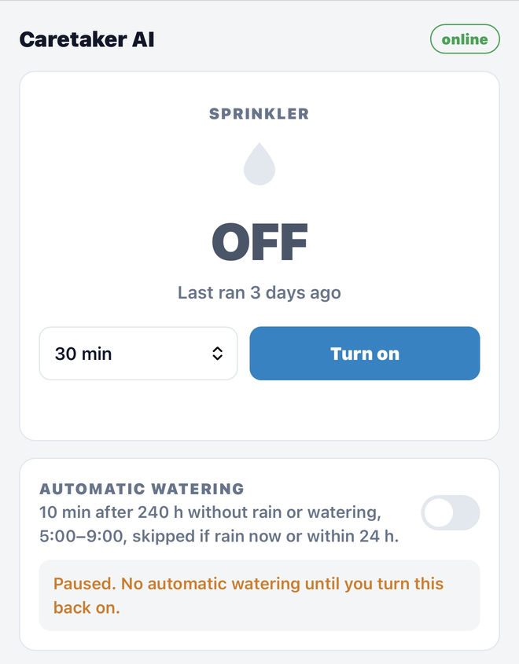
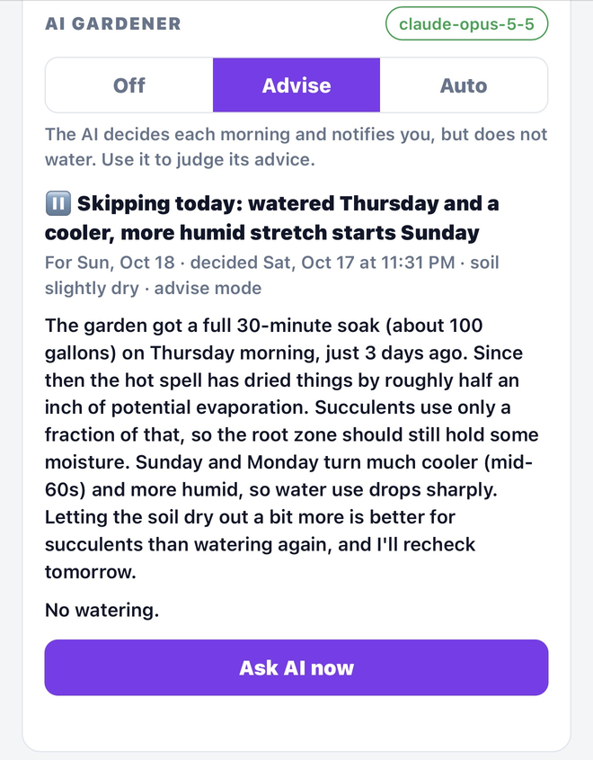
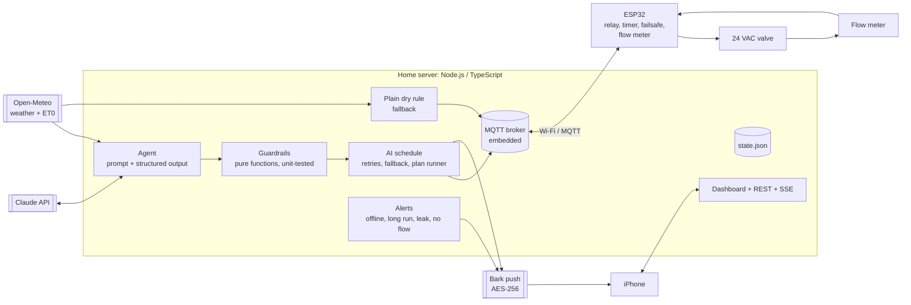

# Caretaker AI

**An AI agent that looks after my home, starting with the garden.**

> An experimental agentic AI system running in the real world, designed and built from
> zero to one by **[Saad Mir](https://www.linkedin.com/in/saadmir/)** with Claude Code. An AI agent makes decisions from live
> environmental data and device events, and acts on physical hardware through ESP32
> microcontrollers, within safety limits enforced in code. The firmware, server and
> hardware integration were all developed with Claude Code.

Every morning, Caretaker AI looks at two weeks of weather, the forecast, how much water
the garden actually got, and my notes, then decides whether to water. If it waters, it
also decides how: several short cycles with soak time between them, so water doesn't
run down a steep slope onto the sidewalk. A guardrail layer in code clamps whatever
the model proposes. An ESP32 next to the valve enforces its own timer and failsafe, and
a flow meter measures the gallons actually used. I get the reasoning as a push
notification on my phone.

Watering is the first job. The same server and MQTT backbone are built to take on the
garage door, front door, cameras, solar-powered lighting and voice assistants next (see
the [roadmap](docs/roadmap.md)).

<p align="center">
  
  &nbsp;
  
</p>
<p align="center"><em>The phone dashboard: valve control and the fallback rule (left), and the AI gardener explaining a decision to skip (right).</em></p>

## What it does today

- **Daily AI decision.** Claude (`claude-opus-5-5`) answers in a validated JSON schema:
  water or skip, start time, cycle lengths, soak time, a soil-moisture estimate, and a
  plain-English explanation.
- **Guardrails the model can't override.** Code caps cycle length, cycle count, daily
  total and soak time, keeps runs inside the morning window, enforces a minimum gap
  between waterings, and stops the plan if it rains.
- **Human in the loop.** Three modes: *Off*, *Advise* (the AI decides and notifies, but
  nothing waters) and *Auto*. Advise mode exists so the AI earns trust before it
  controls the water.
- **Graceful fallback.** If the API fails three times, or with an error that won't fix
  itself, a plain weather-aware rule covers that day.
- **Closed feedback loop.** A Hall-effect flow meter records real gallons per watering.
  The AI sees measured history, not estimates, and the system alerts on a stuck-open
  valve or a dry line.
- **Safety on the device itself.** The ESP32 boots with the valve closed, runs its own
  timer, and has a hard 120-minute failsafe. A dead server or lost Wi-Fi can't leave the
  water on.
- **Live dashboard and private notifications.** A phone-friendly web UI updates over
  server-sent events. Push notifications are end-to-end encrypted (AES-256 via Bark).
  Nothing needs a cloud account except the Claude API.

## Architecture



The design principle: **the model proposes, code disposes.** The AI does the hard part,
judging plant water needs from messy evidence. Everything that could cause harm is
deterministic code that I can test: limits, timing, rain checks, and device-level
failsafes. More in [docs/architecture.md](docs/architecture.md) and
[docs/ai-gardener.md](docs/ai-gardener.md).

### A day in the life

1. **4:30 AM.** The server builds a prompt containing:
   - the garden description
   - 14 days of past weather plus the forecast (rain, ET0, wind, humidity)
   - 30 days of metered waterings
   - the AI's own last seven decisions
   - my notes
2. **Claude decides.** It answers in a schema-validated plan, e.g.
   *"3 × 5 min, 30 min apart, from 5:00 AM."*
3. **Guardrails clamp the plan and log every change.** If the model asks for
   5 × 20 min, it gets 2 × 15 min and I'm told why.
4. **I get a notification** with the headline and reasoning.
5. **The plan runs.** In Auto mode, each cycle starts only if:
   - the ESP32 is online,
   - it isn't raining,
   - the previous cycle ran, and
   - it's been at least 48 h since the last watering.
6. **The ESP32 runs the valve.** It opens the valve with a local timer and streams flow
   readings every 5 s. When the valve closes, the measured gallons become part of
   tomorrow's prompt.

### A real decision

This is the AI's first decision on my garden (also in the screenshot at the top), exactly as it arrived on my phone:

> **Skipping today: watered Thursday and a cooler, more humid stretch starts Sunday**
>
> The garden got a full 30-minute soak (about 100 gallons) on Thursday morning, just 3 days
> ago. Since then the hot spell has dried things by roughly half an inch of potential
> evaporation. Succulents use only a fraction of that, so the root zone should still hold
> some moisture. Sunday and Monday turn much cooler (mid-60s) and more humid, so water use
> drops sharply. Letting the soil dry out a bit more is better for succulents than watering
> again, and I'll recheck tomorrow.

*Soil estimate: slightly dry · guardrail adjustments: none · 3.3k input / 0.7k output tokens.*

The project's original "every 72 hours" rule would have watered again that morning. The AI weighed the actual water applied,
the evaporation since, how succulents use water, and the forecast, then explained its
reasoning in plain words.

## Repository layout

```
server/                 Node.js + TypeScript home server
  src/agent/            the AI gardener: schema, prompt, guardrails, Claude call
  src/watering/         controller, AI schedule, plain dry rule, alerts, flow rate
  src/devices/          device drivers (MQTT): sprinkler today, more to come
  src/mqtt/             embedded MQTT broker
  src/integrations/     Open-Meteo weather, Bark notifications
  src/web/              REST API, live updates (SSE), dashboard snapshot
  public/               dashboard (plain HTML/CSS/JS, no build step)
  test/                 unit tests (node:test)
  tools/                ESP32 simulator for running without hardware
  garden.example.md     template for the garden description the AI reads
firmware/sprinkler/     ESP32 valve controller (PlatformIO, Arduino core 3.x)
deploy/                 installer + systemd unit
docs/                   architecture, AI design, hardware, setup, roadmap
```

## Getting started

```bash
# Try it without any hardware
cd server && npm install && cp .env.example .env   # set LATITUDE, LONGITUDE, MQTT_PASSWORD
npm run dev          # terminal 1: server + dashboard on http://localhost:8080
npm run simulate     # terminal 2: a fake ESP32 with a fake flow meter
npm test             # guardrail, rule and flow-rate tests
```

For the real thing (wiring, flashing the ESP32, installing as a service, Bark, the
Claude API key), see [docs/setup.md](docs/setup.md) and
[docs/hardware.md](docs/hardware.md).

## Documentation

| Doc | What's in it |
|---|---|
| [Architecture](docs/architecture.md) | Components, design decisions and trade-offs, failure modes, MQTT and REST reference |
| [AI gardener](docs/ai-gardener.md) | How the agent decides: inputs, schema, guardrails, modes, fallback, cost |
| [Hardware](docs/hardware.md) | ESP32, relay, 24 VAC valve and flow meter wiring |
| [Setup](docs/setup.md) | Installing the server, flashing the ESP32, notifications, the API key |
| [Roadmap](docs/roadmap.md) | Garage and front doors, cameras, solar LED lighting, a self-healing network watchdog, Alexa/Google, a multi-tool agent |

## How I built this

I built Caretaker AI with **Claude Code** as my pair programmer, and that's
deliberate: the project is also my practice ground for agentic software development.
I owned the problem, the system design, the hardware, and the safety requirements:
- I chose local-first over cloud dependencies, with mDNS instead of router
  configuration and self-hostable push.
- I decided the AI must never be the last line of defense.
- I insisted on Advise mode before Auto.
- I added a flow meter so the agent learns from measured results instead of guesses.

I directed Claude Code through design, implementation, review and refactoring, and
tested on the real hardware as I went. That testing caught a relay glitch at boot, a
firewall rule blocking OTA updates, and a watering default that would have overwatered
the slope.

## License

[MIT](LICENSE) © 2026 Saad Mir
