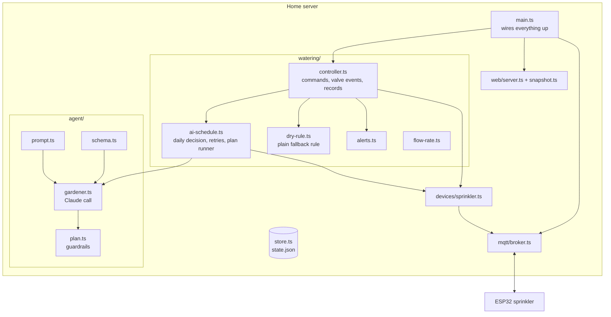

# Architecture

Caretaker AI has three kinds of parts:

| Part | Runs on | Job |
|---|---|---|
| **Home server** | An always-on Linux machine (an old laptop), Node.js + TypeScript | Decisions, scheduling, alerts, dashboard, the MQTT broker, persistence |
| **Device controllers** | ESP32 boards, Arduino C++ | Drive one piece of hardware each and keep it safe on their own |
| **External services** | Claude API, Open-Meteo, Bark | AI decisions, weather, encrypted push notifications |

## Server modules

- **`main.ts`** creates the store, broker, device, controller and web server, and handles shutdown. It's the place to read first.
- **`config.ts`** reads every setting from `.env` into one typed object. Location and secrets have no defaults, so a missing value fails loudly at startup.
- **`store.ts`** keeps all state in one JSON file, rewritten atomically (temp file + rename) so a power cut can't corrupt it. That's plenty for one household; see the trade-offs below.
- **`mqtt/broker.ts`** is an MQTT broker ([aedes](https://github.com/moscajs/aedes)) inside the Node process, with username/password auth. Every ESP32 connects to it, so there's no Mosquitto to install.
- **`devices/sprinkler.ts`** is the driver for the sprinkler ESP32. It sends commands and turns the device's reports into a typed `SprinklerStatus`, including converting flow pulses to gallons. Future devices (garage door, lights) get their own driver next to it.
- **`watering/controller.ts`** owns watering:
  - polls the weather and runs everything else on a 15-second tick,
  - executes dashboard commands,
  - turns valve on/off reports into log entries, watering records (with measured gallons) and notifications.
- **`watering/ai-schedule.ts`**:
  - runs the daily AI decision, with retries and the fallback,
  - starts each planned cycle when it's due, checking again before every cycle that it's still safe.
- **`watering/dry-rule.ts`** is the plain rule from before the AI: "dry for N hours, inside the morning window, no rain now or forecast". It's a pure function and has unit tests.
- **`watering/alerts.ts`**: offline, running long, water flowing with the valve closed, and no flow with the valve open.
- **`agent/`** is the AI gardener; see [ai-gardener.md](ai-gardener.md).
- **`web/`**:
  - a REST API, and a Server-Sent Events stream that pushes the full dashboard snapshot on every change (batched to 100 ms),
  - optional HTTP Basic auth,
  - static files for the dashboard.

## The sprinkler ESP32

`firmware/sprinkler/src/main.cpp` is about 250 lines and deliberately simple. It has no
decision logic; it does a few things it must never get wrong:
- **Boots closed.** The relay pin is latched to "off" before it even becomes an output, so the valve can't twitch on at power-up.
- **Enforces time locally.** Every "on" carries a duration, and the ESP32 closes the valve itself when it runs out. There's also an absolute failsafe (120 min), whatever the server asks for.
- **Never trusts a replay.** Commands are never retained on the broker, so a rebooting ESP32 can't re-run an old "on".
- **Counts flow pulses** in an interrupt (`flow_meter.h`) and reports raw counts. The server converts them, so calibration never needs a re-flash.
- **Finds the server without a fixed IP.** It resolves `MQTT_HOST` (`<hostname>.local`) over mDNS before each connect, and falls back to the last address that worked.
- **Takes updates over Wi-Fi** (ArduinoOTA). The valve is forced closed during a flash.

## Design decisions and trade-offs

| Decision | Why | Trade-off |
|---|---|---|
| Thin firmware, all logic on the server | Logic is easier to change, test and observe in TypeScript; the ESP32 only has to be reliable | The server must be up for anything smart to happen, which is fine because the ESP32 fails safe |
| AI as one structured call per day, not a tool-using loop | The decision needs all the evidence at once, and a single schema-validated answer is cheap, predictable and easy to guard | No "investigation" (e.g. asking for more data). Planned once there are more devices; see the roadmap |
| Guardrails as pure functions | The safety-critical part is deterministic and unit-tested without calling the API | Limits are static settings; the AI can't argue for an exception, by design |
| Advise mode before Auto | The owner can judge the AI's advice against reality before it controls the water | Slower start |
| Embedded MQTT broker | One process to install and monitor; MQTT gives retained state and a last will for free | Not built for thousands of devices, which a home doesn't need |
| mDNS instead of a fixed IP | Works without router configuration (some mesh routers only expose DHCP reservations through a cloud account) | Depends on multicast reaching the ESP32; the last known IP is the fallback |
| JSON file instead of a database | Zero setup, human-readable, atomic writes; a few hundred records | No queries or history beyond the capped lists; SQLite is the next step if needed |
| SSE instead of WebSockets | One-way updates are all the dashboard needs; works through plain HTTP | Commands go over REST, which is fine at this scale |
| Bark with end-to-end encryption | Native iOS notifications with no account; the relay and Apple see only ciphertext | iOS only (ntfy or Pushover would cover Android) |

## Failure modes

| Failure | What happens |
|---|---|
| Claude API down or slow | 3 tries, 10 min apart. Then the day is marked failed, the plain rule takes over, and I get a notification |
| Invalid API key or no credit | No retries; immediate fallback and notification |
| AI asks for too much water | Clamped by the guardrails; each change is logged and included in the notification |
| Weather API down | Retried every minute. The plain rule refuses to water on weather data older than 45 minutes |
| Server crashes mid-run | The ESP32's own timer closes the valve on schedule; systemd restarts the server |
| Wi-Fi drops mid-run | Same: the ESP32 closes the valve on time and reconnects by itself |
| ESP32 offline | Commands are refused, planned cycles wait up to 2 h and are then dropped; offline alert after 3 min |
| Valve stuck open | The flow meter sees water with the valve closed, so an urgent alert tells me to shut the supply. The relay can't fix this |
| No water reaches the garden | "No flow" alert after 90 s with the valve open. The AI also sees the 0-gallon watering the next morning |
| Power cut | State is saved atomically. On boot the ESP32 starts closed and the server picks up where it left off |

## MQTT protocol

Base topic `sprinkler/zone1` (one ESP32 per zone or device).

| Topic | Direction | Payload |
|---|---|---|
| `…/cmd` | server → ESP32 (QoS 1, never retained) | `{"action":"on","durationSec":600,"reason":"ai"}`, `{"action":"off","reason":"manual"}`, `{"action":"ping"}` |
| `…/state` | ESP32 → server (retained) | `{"state":"on","reason":"ai","onForSec":12,"remainingSec":588,"rssi":-61,"ip":"…","fw":"1.1.0","failsafeMin":120,"flowPulses":51234,"runPulses":4210,"flowPps":14.4}`. Sent on every change, every 30 s, and every 5 s while water flows |
| `…/availability` | ESP32 → server (retained, last will) | `online` / `offline` |

## REST API

| Method and path | Purpose |
|---|---|
| `GET /api/status` | Full dashboard snapshot |
| `GET /api/stream` | Server-Sent Events: the snapshot on connect and on every change |
| `POST /api/valve` `{"action":"on","minutes":30}` / `{"action":"off"}` | Manual run (`minutes: 0` = until stopped, still capped by the failsafe) |
| `POST /api/auto` `{"enabled":false}` | Pause or resume automatic watering |
| `POST /api/ai/mode` `{"mode":"advise"}` | `off`, `advise` or `auto` |
| `POST /api/ai/decide` | Ask the AI now |
| `POST /api/notes` `{"text":"…"}` · `POST /api/notes/delete` `{"at":"…"}` | Garden notes for the AI |
| `POST /api/weather/refresh` | Fetch the weather now |
