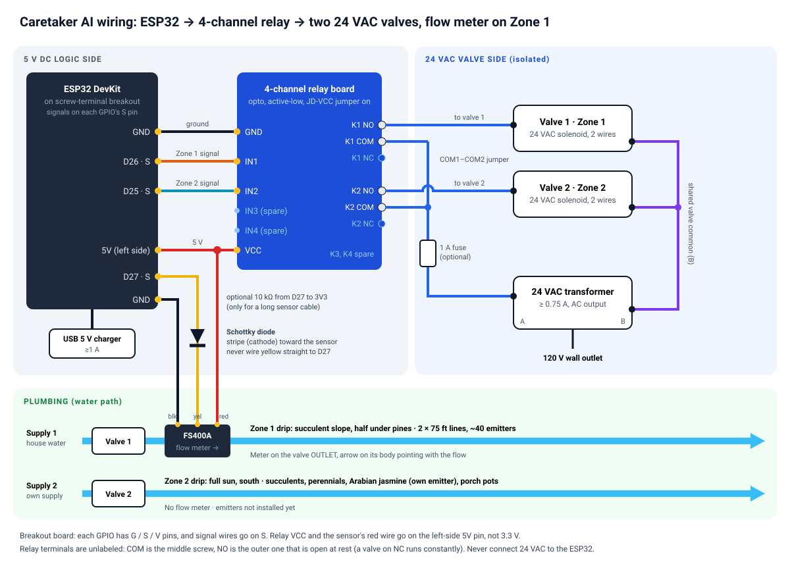

# Hardware: sprinkler controller

How the sprinkler ESP32, relay, 24 VAC valve and flow meter connect. The firmware is in
`firmware/sprinkler/`, and its settings (pins, relay polarity) are in `include/config.h`.



## First, what your parts actually are

**The relay (SRD-05VDC-SL-C).** This is a Songle *electromechanical* relay with a **5 V DC coil**, not a solid-state relay. It's a switch only and **does not convert 110 V to 24 V**. Its contacts are rated 10 A at 250 VAC, which is far more than a sprinkler valve needs (about 0.2–0.4 A), so it's a good fit.

**The 24 V supply (you need to buy this).** Nothing powers the valve right now, so you need a **24 VAC plug-in transformer**, the kind sold as a "sprinkler controller replacement transformer" (about $10–20). Get one rated **≥ 0.75 A (≥ 18 VA)**.
- It must be **AC**, not DC. Sprinkler solenoids are built for AC. On 24 VDC they draw much more current and can overheat.
- A plug-in unit means you never touch 120 V wiring.

**ESP32 power.** Use any USB phone charger (5 V, ≥ 1 A) and a USB cable that carries data (micro-USB on most ESP-WROOM-32 DevKits, USB-C on some).

### Shopping list

| Item | Notes |
|---|---|
| 24 VAC plug-in transformer, ≥ 0.75 A | Orbit, Rain Bird, Hunter replacements all work |
| USB 5 V charger + cable | Use a data cable so you can also flash firmware with it |
| 3× female-female Dupont jumper wires | ESP32 ↔ relay module |
| Wire nuts or Wago 221 lever connectors | Valve wires |
| 18–20 AWG sprinkler/bell wire | Only if your valve wires don't already reach the box |
| Small project box | Indoors (garage) or an outdoor-rated box |
| *(optional)* 1 A inline fuse holder + fuse | On the 24 VAC side |
| *(only if needed, see below)* 2N2222 or 2N3904 NPN transistor + 1 kΩ resistor | Relay won't release, or bare relay |
| *(only for a bare relay)* 1N4007 diode | Flyback protection |

---

## Step 0: Which relay form do you have?

**A) Relay module (most likely).** A small PCB with the blue relay cube, a 3-pin header (`VCC`/`GND`/`IN`, or `DC+`/`DC-`/`IN`), and 3 screw terminals (`NO`/`COM`/`NC`). → Follow **Section 1**.

**B) Bare relay.** Just the blue cube with 5 pins underneath. → Follow **Section 2**. It needs a transistor driver because a GPIO pin can't power the coil directly.

---

## Section 1: Relay module wiring

### 1a. ESP32 → relay module (low-voltage DC side)

| ESP32 pin | Relay module pin | Wire |
|---|---|---|
| `VIN` (sometimes `5V`) | `VCC` / `DC+` | red |
| `GND` | `GND` / `DC-` | black |
| `GPIO 26` (labeled `D26`, `G26`, or `IO26`) | `IN` | yellow / any |

`VIN` puts out about 5 V when the ESP32 is powered over USB, which the relay coil needs. Don't use the `3V3` pin for `VCC`, because the coil won't pull in.

**If your module has an `H`/`L` trigger jumper**, set it to **`H`** and set `RELAY_ACTIVE_LOW false` in `config.h`. High-trigger works best with 3.3 V logic.

**If it has no jumper**, leave `RELAY_ACTIVE_LOW true` (most such boards are active-low).

### 1b. Relay → valve → transformer (24 VAC side)

1. Leave the transformer **unplugged**.
2. Transformer terminal **A** → (optional 1 A fuse) → relay **`COM`**.
3. Relay **`NO`** (normally open) → **either** valve solenoid wire. AC solenoids have no polarity.
4. Other valve solenoid wire → transformer terminal **B**. This is the "common" wire.
5. Leave **`NC`** empty. If you use `NC` instead of `NO`, the valve stays open whenever the ESP32 is unpowered.

With multiple valves later, every valve's second wire joins together onto **B** (the common). Each valve's first wire goes to its own relay's `NO`.

### 1c. Bench test (before connecting the valve)

1. Flash the firmware (see [setup.md](setup.md#3-flash-the-esp32)) and power the ESP32 over USB. Do **not** connect the transformer yet.
2. From the dashboard, turn the sprinkler **on**. You should hear a click and see the module's LED light.
3. Turn it **off**. You should hear a second click and see the LED go out.

**Troubleshooting:**

| Symptom | Fix |
|---|---|
| ON and OFF are reversed | Flip `RELAY_ACTIVE_LOW` in `config.h` and re-flash |
| Relay clicks ON but **never releases** (LED stays dim or on) | This is a common problem with active-low 5 V modules driven from 3.3 V logic: 3.3 V isn't high enough to fully switch the optocoupler off. Use one of the fixes below |
| No click at all | Check `VIN` is about 5 V with a multimeter. Check that GPIO 26 is really the pin you wired |

**Fixes for "relay never releases"** (pick one):

- **If the module has a `JD-VCC` jumper:** remove the jumper, connect `JD-VCC` to ESP32 `VIN` (5 V), and connect `VCC` to ESP32 `3V3`. Keep `RELAY_ACTIVE_LOW true`.
- **Otherwise, add an NPN transistor as a buffer:**
  - GPIO 26 → 1 kΩ resistor → transistor **base**.
  - Transistor **emitter** → GND.
  - Transistor **collector** → module `IN`.
  - Set `RELAY_ACTIVE_LOW false`. The transistor inverts the logic: GPIO high pulls `IN` low, which turns the relay on.

  On a 2N2222 or 2N3904 with the flat face toward you, legs down, the pins are E-B-C from left to right.

### 1d. Final test with the valve

1. Plug in the transformer.
2. Optionally, measure across the two valve wires with a multimeter on **AC volts**. Expect about 0 V when off and about 24–28 VAC when on. Some transformers read up to 30 VAC with no load, which is normal.
3. Turn the valve on from the dashboard. The valve should click and water should flow within a few seconds.
4. Turn it off. Water should stop in a few seconds.

You can also measure the solenoid by itself, with power off and wires disconnected. A healthy coil reads about **20–60 Ω**. 0 Ω means a short; infinite means an open coil or a broken wire.

---

## Section 2: Bare SRD-05VDC-SL-C relay

The coil draws about 70–90 mA at 5 V. A GPIO pin can only supply about 20 mA at 3.3 V, so you need a transistor.

**Identify the pins** with a multimeter on Ω:
- The two **coil** pins read about **70 Ω** to each other.
- **COM** reads 0 Ω to **NC** at rest, and open to **NO**.
- The pin layout is usually also printed on the relay's top.

**Driver circuit:**

```
ESP32 VIN (5V) ─────────────┬──────────────┐
                            │              │
                       coil pin 1      1N4007 diode
                       [ RELAY COIL ]   (stripe/cathode toward 5V)
                       coil pin 2          │
                            │              │
                            ├──────────────┘
                            │
                        collector
ESP32 GPIO26 ──[1kΩ]── base   2N2222 / 2N3904 (NPN)
                        emitter
                            │
ESP32 GND ──────────────────┘
```

- The **diode is mandatory**. It absorbs the coil's voltage spike when the relay turns off. Without it, the transistor or the ESP32 will eventually fail.
- Set `RELAY_ACTIVE_LOW false`.
- Wire the contact side (COM / NO / transformer / valve) exactly as in step **1b**.

---

## Flow sensor

A Hall-effect flow meter (for example the **FS400A G1"**, 1–60 L/min) on the valve's **outlet** side lets the server log the gallons of every watering. Inside, a magnet on the turbine passes a Hall sensor, which gives one pulse per bit of water: about **288 pulses per liter** (pulse frequency = 4.8 × L/min).

The sensor has 3 wires:

| Wire | Function |
|---|---|
| Red | Power, 5–24 V DC |
| Black | Ground |
| Yellow | Pulse output |

**Why not wire yellow straight to the ESP32?** The sensor needs 5 V. Its output swings to about 5 V, but ESP32 pins take at most 3.3 V. A plain resistor divider only works if you know the sensor's internal output circuit, which these listings don't say. A **diode** works with any of them: it lets the sensor pull the pin *down* and blocks its 5 V from reaching the pin. The ESP32's pull-up supplies the 3.3 V "high".

### Parts
- 1 small diode, ideally a **Schottky**: 1N5817, 1N5819, BAT85 or BAT43. A 1N4148 also works.
- 1 × 10 kΩ resistor. This is optional for a short cable, but recommended for a long one.
- 3-wire cable from the valve to the ESP32 box.

### Connections

| Sensor wire | Goes to |
|---|---|
| Red | ESP32 `VIN` (5 V), same pin as the relay board's `VCC` |
| Black | ESP32 `GND` |
| Yellow | Diode **stripe (cathode)** side. The other end of the diode goes to ESP32 **`GPIO 27`** |

Also connect the optional 10 kΩ resistor between `GPIO 27` and `3V3`.

```
                        diode (stripe toward sensor)
sensor yellow ──────────────|◄──────────── GPIO 27
                                              │
                                            [10k]   (optional)
                                              │
                                             3V3
sensor red   ───────────────────────────── VIN (5V)
sensor black ───────────────────────────── GND
```

`GPIO 27` is right next to the relay's `GPIO 26` on most DevKits. It's set by `FLOW_PIN` in `config.h`.

### Installation tips
- Mount the sensor with the **arrow on its body pointing in the flow direction**. Put it on the outlet side of the valve, so it only sees water that the valve lets through. Use Teflon tape on the 1" threads.
- Keep the sensor out of direct sun if you can, and put the wire splice in a waterproof (gel-filled) connector.
- For a long cable to the ESP32 box, use a twisted or shielded cable, and fit the 10 kΩ resistor. The firmware also ignores glitches shorter than 1 ms.
- The sensor needs at least about 1 L/min (0.26 gal/min) to turn. 40 drip emitters are well above that.

### Check it
1. Flash firmware 1.1.0 or later. The dashboard's **Controller → Flow sensor** row then shows a reading instead of "not reporting".
2. Turn the valve on. Within about 10 s the hero card shows **gal/min** and the running gallon total.
3. If it stays at 0 gal/min with water flowing, check that the diode stripe points at the sensor and that red reads about 5 V to black.

### Calibrate (optional)
1. Read the house water meter, run the valve for 10 minutes with no other water in use, then read the meter again.
2. Compare the meter with the gallons logged for that watering.
3. Set `FLOW_PULSES_PER_LITER` in the server's `.env` to `288 × logged ÷ meter`.
4. Run `sudo systemctl restart caretaker`. No firmware change is needed.

### Alerts it adds
- **Water flowing with valve closed** (urgent). The valve is stuck open, usually from debris in the diaphragm, or a line is leaking. Turning the relay off can't fix that, so close the supply.
- **No water flowing** while the valve is open. The supply is shut, the transformer is unplugged, the solenoid has failed, or the sensor isn't wired.

---

## Safety and installation notes

- **Keep the two sides separate.** The ESP32 and relay coil are on 5 V DC. The valve and transformer are on 24 VAC. The relay contacts are the only link between them. Never connect any 24 VAC wire to an ESP32 pin.
- **Failsafe.** The firmware closes the valve on its own after the requested run time, and always after `FAILSAFE_MAX_MINUTES` (default 120). This holds even if Wi-Fi or the laptop dies. On power-up the valve is always **off**.
- **Where to put it.** Mount the ESP32 and relay indoors (for example, the garage) near an outlet. Run the existing 2-wire valve cable (or new 18 AWG sprinkler wire) to the valve. 24 VAC is fine over long runs: 18 AWG works out to a few hundred feet.
- **Wi-Fi signal.** The dashboard shows RSSI. Aim for better than −75 dBm. If it's weaker, move the box closer to the router or use an ESP32 board with an external antenna.
- **Outdoors.** Use an IP65 box with a cable gland and add a silica gel pack. Make valve wire splices with grease-filled waterproof connectors (for example, DBY).
